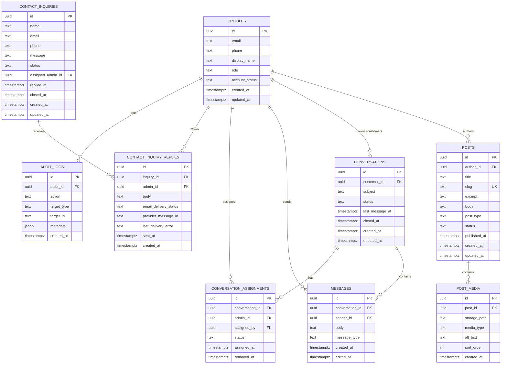

# Database Schema & Data Models

## 1. Entity Relationship (ER) Diagram

---

## 2. Table Specifications & Constraints

### 2.1 `profiles`
- **Purpose:** Stores authenticated user profile and trusted authorization role. Tied 1:1 with `auth.users`.
- **Columns:**
  - `id`: `UUID PRIMARY KEY REFERENCES auth.users(id) ON DELETE CASCADE`
  - `email`: `TEXT`
  - `phone`: `TEXT`
  - `display_name`: `TEXT NOT NULL DEFAULT 'User'`
  - `role`: `TEXT NOT NULL CHECK (role IN ('customer', 'admin', 'super_admin')) DEFAULT 'customer'`
  - `account_status`: `TEXT NOT NULL CHECK (account_status IN ('active', 'suspended', 'pending')) DEFAULT 'active'`
  - `created_at`: `TIMESTAMPTZ NOT NULL DEFAULT timezone('utc', now())`
  - `updated_at`: `TIMESTAMPTZ NOT NULL DEFAULT timezone('utc', now())`
- **Security Constraint:** Users cannot update their own `role` or `account_status`. Only `super_admin` or trusted service-role triggers can update roles.
- **Indexes:**
  - `CREATE INDEX idx_profiles_role ON profiles(role);`

### 2.2 `posts`
- **Purpose:** Holds CMS content for blogs, posters, and photos.
- **Columns:**
  - `id`: `UUID PRIMARY KEY DEFAULT gen_random_uuid()`
  - `author_id`: `UUID NOT NULL REFERENCES profiles(id) ON DELETE RESTRICT`
  - `title`: `TEXT NOT NULL`
  - `slug`: `TEXT NOT NULL UNIQUE`
  - `excerpt`: `TEXT`
  - `body`: `TEXT`
  - `post_type`: `TEXT NOT NULL CHECK (post_type IN ('blog', 'poster', 'photo'))`
  - `status`: `TEXT NOT NULL CHECK (status IN ('draft', 'published', 'archived')) DEFAULT 'draft'`
  - `cover_image`: `TEXT`
  - `published_at`: `TIMESTAMPTZ`
  - `created_at`: `TIMESTAMPTZ NOT NULL DEFAULT timezone('utc', now())`
  - `updated_at`: `TIMESTAMPTZ NOT NULL DEFAULT timezone('utc', now())`
- **Indexes:**
  - `CREATE INDEX idx_posts_type_status_published ON posts(post_type, status, published_at DESC);`
  - `CREATE UNIQUE INDEX idx_posts_slug ON posts(slug);`

### 2.3 `post_media`
- **Purpose:** Normalized media attachments for posts (especially photo galleries).
- **Columns:**
  - `id`: `UUID PRIMARY KEY DEFAULT gen_random_uuid()`
  - `post_id`: `UUID NOT NULL REFERENCES posts(id) ON DELETE CASCADE`
  - `storage_path`: `TEXT NOT NULL`
  - `media_type`: `TEXT NOT NULL CHECK (media_type IN ('image/jpeg', 'image/png', 'image/webp', 'image/avif'))`
  - `alt_text`: `TEXT`
  - `sort_order`: `INTEGER NOT NULL DEFAULT 0`
  - `created_at`: `TIMESTAMPTZ NOT NULL DEFAULT timezone('utc', now())`
- **Indexes:**
  - `CREATE INDEX idx_post_media_post_sort ON post_media(post_id, sort_order ASC);`

### 2.4 `conversations`
- **Purpose:** Authenticated live-chat conversation threads.
- **Columns:**
  - `id`: `UUID PRIMARY KEY DEFAULT gen_random_uuid()`
  - `customer_id`: `UUID NOT NULL REFERENCES profiles(id) ON DELETE CASCADE`
  - `subject`: `TEXT DEFAULT 'General Support'`
  - `status`: `TEXT NOT NULL CHECK (status IN ('open', 'in_progress', 'resolved', 'closed')) DEFAULT 'open'`
  - `last_message_at`: `TIMESTAMPTZ NOT NULL DEFAULT timezone('utc', now())`
  - `closed_at`: `TIMESTAMPTZ`
  - `created_at`: `TIMESTAMPTZ NOT NULL DEFAULT timezone('utc', now())`
  - `updated_at`: `TIMESTAMPTZ NOT NULL DEFAULT timezone('utc', now())`
- **Indexes:**
  - `CREATE INDEX idx_conversations_customer ON conversations(customer_id);`
  - `CREATE INDEX idx_conversations_status ON conversations(status);`
  - `CREATE INDEX idx_conversations_last_message ON conversations(last_message_at DESC);`

### 2.5 `conversation_assignments`
- **Purpose:** Many-to-many relationship mapping multiple admins to a single customer conversation.
- **Columns:**
  - `id`: `UUID PRIMARY KEY DEFAULT gen_random_uuid()`
  - `conversation_id`: `UUID NOT NULL REFERENCES conversations(id) ON DELETE CASCADE`
  - `admin_id`: `UUID NOT NULL REFERENCES profiles(id) ON DELETE CASCADE`
  - `assigned_by`: `UUID REFERENCES profiles(id) ON DELETE SET NULL`
  - `status`: `TEXT NOT NULL CHECK (status IN ('active', 'removed')) DEFAULT 'active'`
  - `assigned_at`: `TIMESTAMPTZ NOT NULL DEFAULT timezone('utc', now())`
  - `removed_at`: `TIMESTAMPTZ`
- **Unique Constraint:**
  - `CREATE UNIQUE INDEX idx_unique_active_assignment ON conversation_assignments(conversation_id, admin_id) WHERE (status = 'active');`
- **Indexes:**
  - `CREATE INDEX idx_assignments_admin ON conversation_assignments(admin_id, status);`
  - `CREATE INDEX idx_assignments_conv ON conversation_assignments(conversation_id, status);`

### 2.6 `messages`
- **Purpose:** Real-time messages within live-chat conversations.
- **Columns:**
  - `id`: `UUID PRIMARY KEY DEFAULT gen_random_uuid()`
  - `conversation_id`: `UUID NOT NULL REFERENCES conversations(id) ON DELETE CASCADE`
  - `sender_id`: `UUID NOT NULL REFERENCES profiles(id) ON DELETE CASCADE`
  - `body`: `TEXT NOT NULL CHECK (length(trim(body)) > 0 AND length(body) <= 5000)`
  - `message_type`: `TEXT NOT NULL CHECK (message_type IN ('text', 'system', 'media')) DEFAULT 'text'`
  - `created_at`: `TIMESTAMPTZ NOT NULL DEFAULT timezone('utc', now())`
  - `edited_at`: `TIMESTAMPTZ`
- **Indexes:**
  - `CREATE INDEX idx_messages_conv_created ON messages(conversation_id, created_at ASC);`
  - `CREATE INDEX idx_messages_sender ON messages(sender_id);`

### 2.7 `contact_inquiries`
- **Purpose:** Stores public guest inquiries from the Contact Us form.
- **Columns:**
  - `id`: `UUID PRIMARY KEY DEFAULT gen_random_uuid()`
  - `name`: `TEXT`
  - `email`: `TEXT NOT NULL`
  - `phone`: `TEXT NOT NULL`
  - `message`: `TEXT NOT NULL CHECK (length(trim(message)) >= 10 AND length(message) <= 5000)`
  - `status`: `TEXT NOT NULL CHECK (status IN ('new', 'in_progress', 'replied', 'closed')) DEFAULT 'new'`
  - `assigned_admin_id`: `UUID REFERENCES profiles(id) ON DELETE SET NULL`
  - `replied_at`: `TIMESTAMPTZ`
  - `closed_at`: `TIMESTAMPTZ`
  - `created_at`: `TIMESTAMPTZ NOT NULL DEFAULT timezone('utc', now())`
  - `updated_at`: `TIMESTAMPTZ NOT NULL DEFAULT timezone('utc', now())`
- **Indexes:**
  - `CREATE INDEX idx_contact_inquiries_status ON contact_inquiries(status);`
  - `CREATE INDEX idx_contact_inquiries_created ON contact_inquiries(created_at DESC);`
  - `CREATE INDEX idx_contact_inquiries_assigned ON contact_inquiries(assigned_admin_id);`

### 2.8 `contact_inquiry_replies`
- **Purpose:** Stores staff email responses to guest inquiries.
- **Columns:**
  - `id`: `UUID PRIMARY KEY DEFAULT gen_random_uuid()`
  - `inquiry_id`: `UUID NOT NULL REFERENCES contact_inquiries(id) ON DELETE CASCADE`
  - `admin_id`: `UUID NOT NULL REFERENCES profiles(id) ON DELETE RESTRICT`
  - `body`: `TEXT NOT NULL CHECK (length(trim(body)) > 0)`
  - `email_delivery_status`: `TEXT NOT NULL CHECK (email_delivery_status IN ('pending', 'sent', 'failed')) DEFAULT 'pending'`
  - `provider_message_id`: `TEXT`
  - `last_delivery_error`: `TEXT`
  - `sent_at`: `TIMESTAMPTZ`
  - `created_at`: `TIMESTAMPTZ NOT NULL DEFAULT timezone('utc', now())`
- **Indexes:**
  - `CREATE INDEX idx_inquiry_replies_inquiry ON contact_inquiry_replies(inquiry_id, created_at ASC);`

### 2.9 `audit_logs`
- **Purpose:** Immutable audit trail for security and administrative actions.
- **Columns:**
  - `id`: `UUID PRIMARY KEY DEFAULT gen_random_uuid()`
  - `actor_id`: `UUID REFERENCES profiles(id) ON DELETE SET NULL`
  - `action`: `TEXT NOT NULL`
  - `target_type`: `TEXT NOT NULL`
  - `target_id`: `TEXT`
  - `metadata`: `JSONB DEFAULT '{}'::jsonb`
  - `created_at`: `TIMESTAMPTZ NOT NULL DEFAULT timezone('utc', now())`
- **Indexes:**
  - `CREATE INDEX idx_audit_logs_actor ON audit_logs(actor_id);`
  - `CREATE INDEX idx_audit_logs_action ON audit_logs(action);`
  - `CREATE INDEX idx_audit_logs_created ON audit_logs(created_at DESC);`

---

## 3. Storage Buckets & Policies (`storage.objects`)

### 3.1 Bucket Definitions
| Bucket Name | Public Access | Size Limit | Allowed MIME Types | Intended Use |
| :--- | :--- | :--- | :--- | :--- |
| `public-media` | `true` (Public) | 5 MB | `image/jpeg`, `image/png`, `image/webp`, `image/avif` | Published cover images, poster showcase graphics, photo gallery assets |
| `draft-media` | `false` (Private) | 5 MB | `image/jpeg`, `image/png`, `image/webp`, `image/avif` | Unpublished drafts, prototypes, work-in-progress content. Preview requires signed URL |

### 3.2 Storage Policies on `storage.objects`
1. **Public Read on `public-media`:**
   - Permitted for `role() = 'anon'` or `role() = 'authenticated'`.
   - Expression: `bucket_id = 'public-media'`
2. **Staff Read on `draft-media`:**
   - Permitted only for authenticated users where `profiles.role IN ('admin', 'super_admin')`.
   - Expression: `bucket_id = 'draft-media' AND EXISTS (SELECT 1 FROM profiles WHERE profiles.id = auth.uid() AND profiles.role IN ('admin', 'super_admin'))`
3. **Staff Upload (INSERT) on `public-media` and `draft-media`:**
   - Permitted only for authenticated users where `profiles.role IN ('admin', 'super_admin')`.
4. **Staff Update / Delete on `public-media` and `draft-media`:**
   - Permitted only for authenticated users where `profiles.role IN ('admin', 'super_admin')`.

